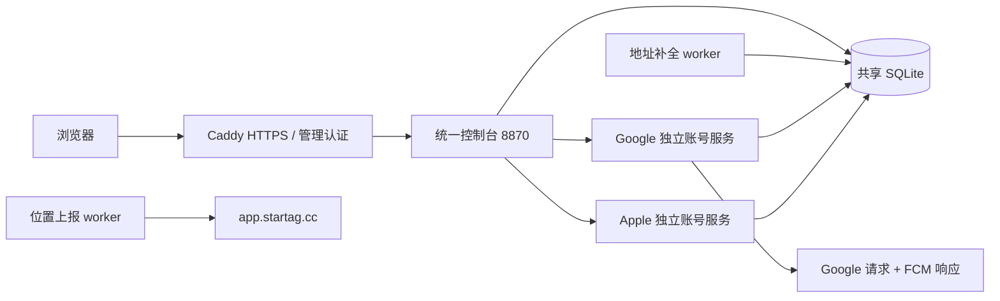

# Google / Apple FindMy 服务端

本仓库是 2026-11-13 从阿里云运行实例提取的源码快照，包含统一控制台后端、Apple / Google 采集器、共享位置库、地址补全和第三方位置上报。它不是账号、设备或历史数据库备份。前端与 Windows 打印助手在 [findmy_web](https://github.com/wenhaoran-seven/findmy_web)。

## 新人先读

1. 阅读本文件的架构、配置和权限说明。
2. 克隆两个仓库，安装开发依赖，运行测试。
3. 使用测试账号与空数据库开发，不连接生产账号和位置库。
4. 前后端配套发布：网页源码不在本仓库，需执行前端仓库的资源安装脚本。
5. 当前不是通用的一键安装产品：原生产路径、端口和部分来源标识仍保留。部署到新环境前必须调整配置，并自行完成账号授权。

## 目录与进程

|目录|职责|原部署路径 / 监听端口|
|---|---|---|
|services/findmy-console|FastAPI 统一 API、账号管理、设备导入、轨迹、公开只读接口|/opt/findmy-console / 127.0.0.1:8870|
|services/findmy|Apple FindMy、会话保存、调度、CoreADI 适配|/opt/findmy / 127.0.0.1:8765|
|services/google-findmy|Google 账号1采集器、FCM 接收、注册/续报|/opt/google-findmy / 127.0.0.1:8767|
|services/google-findmy-2|Google 账号2部署版本；新 Google 账号模板来源|/opt/google-findmy-2 / 127.0.0.1:8769|
|services/google-findmy-3|Google 账号3部署版本|/opt/google-findmy-3 / 127.0.0.1:8771|
|services/findmy-address-worker|共享地址缓存、百度优先及回退|/opt/findmy-address-worker|
|services/startag-google-reporter|读取已有位置，上报 app.startag.cc，持久化待发送队列|/opt/startag-google-reporter|
|tests|统一控制台的自动化测试|临时数据库|
|deploy|无凭据的配置示例|须按环境替换|
|SOURCE_SNAPSHOT.json|提取时源文件 SHA256 清单|不含运行数据|

三个 Google 目录是实际部署副本，可能存在来源标识和实现差异，不能不经比较就合并。Apple 新账号复用 Apple 代码，但独立运行进程和数据目录。源码提取清单是提取时校验信息，后续整理、修复和测试路径调整会改变个别文件哈希。

## 数据流程



- 设备按 SN 合并展示；各采集器仍保存各自账号状态、密钥与历史缓存。
- 共享库默认生产位置为 `/var/lib/findmy-locations/locations.sqlite3`，包括 locations、location_versions、地址缓存和控制台管理表。
- 原始坐标保留 WGS84；地图显示转换和逆地址编码是另外的处理层，不应覆盖原始经纬度。
- 地址缓存跨设备/平台复用，附近 100 米可复用，旧记录由后台逐步补全。百度额度和限速由独立 worker 控制。
- Google 的请求触发与 FCM 返回是两个阶段；Uploading、ASSIGN_LOCATION、请求被接受均不等于位置上传成功。
- `unknown_11` 的含义尚未确认。deviceMetadata.field12 暂按服务端响应生成时间理解；目前只是分析结论，未替换位置时间或新增生产解析字段。

## 本地开发

建议 Python 3.12+、Git、Node.js 20+（运行另一个仓库的前端测试）。以下命令在仓库根目录运行：

```bash
git clone https://github.com/wenhaoran-seven/google_apple_findmy_sever.git
git clone https://github.com/wenhaoran-seven/findmy_web.git
cd google_apple_findmy_sever
python -m venv .venv
# Linux/macOS
source .venv/bin/activate
# Windows PowerShell 使用 .\.venv\Scripts\Activate.ps1
python -m pip install -r requirements-dev.txt
python ../findmy_web/scripts/install_assets.py --target services
python -m unittest discover -s tests -p 'test_*.py'
```

启动控制台示例（Linux）：

```bash
export FINDMY_LOCATION_DB="$PWD/.local/locations.sqlite3"
export FINDMY_PUBLIC_ORIGINS='["http://127.0.0.1:8870"]'
export FINDMY_MAP_ORIGIN='http://127.0.0.1:8765'
python -m uvicorn app:app --app-dir services/findmy-console --host 127.0.0.1 --port 8870
```

控制台初始化会建立表和默认账号记录；采集器没有运行时，账号不可用属于预期现象。不要为了消除提示导入生产凭据。没有地图 AK / 配套地图服务时，百度图层可能不可用，列表/API测试不依赖百度。

采集器必须分别安装依赖并运行，不能只安装控制台依赖：

```bash
# 各采集器目录独立虚拟环境
cd services/google-findmy
python -m venv .venv
.venv/bin/python -m pip install -r requirements.txt
# 如需复现原依赖，可检查 requirements.lock.txt；以目标系统兼容性为准
GOOGLEFINDMY_DATA=/absolute/test/google1 FINDMY_SOURCE=google1 \
 FINDMY_LOCATION_DB=/absolute/test/locations.sqlite3 \
 .venv/bin/python -m uvicorn app:app --host 127.0.0.1 --port 8767
```

Apple 在 `services/findmy` 安装 requirements.txt 后运行 `python -m uvicorn localfindmy.app:app --host 127.0.0.1 --port 8765`。实际位置查询还需要 Apple 登录/二次认证、可用的 CoreADI 运行资源；CoreADI 二进制没有上传，需要合法取得并通过 FINDMY_ADI_BINARY 配置。Google 需要完成该账号的登录和加密数据授权；授权缓存不在仓库中。

## 配置

|变量|用途|
|---|---|
|FINDMY_LOCATION_DB|所有服务共用 SQLite 绝对路径|
|FINDMY_SOURCE|来源 ID，例如 apple、apple2、google1；必须按账号唯一|
|FINDMY_DATA_DIR|Apple 独立私有数据目录|
|GOOGLEFINDMY_DATA|Google 独立私有数据目录|
|FINDMY_VAULT_KEY|Apple 数据加密密钥，切勿随意更换已有环境的值|
|FINDMY_ADI_BINARY|CoreADI 运行文件路径|
|FINDMY_HTTPS_PROXY / GOOGLEFINDMY_PROXY|各采集器出站代理；HTTPS 目标也可以使用 http:// 代理的 CONNECT 隧道|
|FINDMY_CONSOLE_TOKEN_FILE|控制台本地接口防误用令牌文件，生产应固定并限制权限|
|FINDMY_PUBLIC_ORIGINS|JSON数组，允许的网页 Origin|
|FINDMY_MAP_ORIGIN / FINDMY_MAP_PARENTS|地图 iframe 地址 / 允许的父页面|
|BAIDU_MAP_AK_FILE|百度服务端 AK 文件路径，不提交 AK|
|BAIDU_REQUEST_INTERVAL / BAIDU_REQUESTS_PER_HOUR|地址请求间隔/小时限额，须符合购买配额|

更多开关请检索对应服务 `os.environ`；`deploy/console.env.example` 仅是示例，不是完整生产环境文件。当前代码仍存在旧公网地址等非秘密默认值，新域名需同时调整 API Origin、地图父页面、Caddy、前端 iframe 和打印助手 Origin 白名单。

## 账号隔离与生产部署

- 每个账号独立进程、数据目录、授权会话；共享的是位置库，不是账号凭据。
- `provisioner.py` 会创建系统用户、systemd unit，按 `/opt` 固定模板复制运行配置；它需要受控特权，不能以普通开发测试方式随意启动。
- 新账号数据默认 `/var/lib/findmy-accounts/<account-id>`；动态端口19000–19999，仅绑定loopback。
- 生产需要 `findmylocations` 共享组和库文件权限，服务的 UMask=0007；不要设置全局777权限。
- 生产步骤：备份 → 安装各服务/依赖 → 放置外部凭据与运行资产 → 安装前端静态文件 → 配置systemd环境 → 配置Caddy证书与管理员密码哈希 → 检查localhost → 对外开放HTTPS。
- 服务更新前备份代码和配置，数据库通过SQLite backup API生成一致性备份；复制正在写入的单个.sqlite文件可能不完整。
- Caddy 示例不自带可信证书。域名可使用合适的ACME签发；IP证书需支持IP的CA和独立续期流程。本仓库不包含证书、ACME账号或生产Caddy密码哈希。
- 本次源码整理不替换线上服务，也不会自动登录、注册设备或重新上报位置。

## 管理页面与公开只读入口

`/` 为受 Caddy 登录保护的管理页面。`/view` 是**明确公开、免登录**的设备列表，可查看位置、轨迹和导出，链接持有者可以读取这些位置。后台对应 `/view/devices`、`/view/track` 仅允许GET/HEAD，使用字段白名单，不返回账号邮箱、EIK或私钥。不要仅靠隐藏按钮实现权限。

管理接口的 X-Local-Token 不是用户登录机制；真正的公网认证在网关。禁止直接将8870或采集器端口开放公网。若不需要公开位置，在Caddy中把 `/view*` 也放到认证范围。

轨迹 `/api/unified-track` 与 `/view/track` 支持 sn、start/end（Unix秒）、platform、limit、cursor：首批10点，后续200点，以时间和ID游标读取，并限制本次扫描的最大ID。加载完成后才启用完整导出。数据库写入新点不会导致分页重复；它不是覆盖全部字段更新的长期事务快照。

## 测试与常见问题

- `python -m unittest discover -s tests -p 'test_*.py'`：控制台、批量添加、公开只读隔离。
- 前端仓库 `npm test`：真实页面脚本组合、轨迹点击、时间选择器、分批加载、CSV/JSON导出。
- 管理页面401：检查网关登录；API403：检查Token、Origin和Host；公开POST403是正确行为。
- 能显示列表但查不到新位置：分别检查账号授权、代理/FCM连通、注册/续报、任务状态和日志，不能仅重启网页解决。
- 轨迹打不开：浏览器控制台、静态资源版本、time.js依赖和地图iframe配置；只读页没有管理员全局变量，通用组件不能依赖它们。
- 打印失败不是阿里云采集器问题；参见前端仓库本地打印服务。

## 源码与许可证

Google `upstream/` 包含 GoogleFindMyTools 派生代码及 GPL-3.0 许可证，保留 LICENSE、UPSTREAM_COMMIT（当前记录660be5395702ff7f1a6174f4ec4c865a57c7b527）。Apple Python库由 requirements安装；第三方组件遵循各自许可证，不因放入新仓库而重新许可。没有复制第三方二进制运行库。

明确排除：账号密码/Token、设备密钥与SN清单、位置数据库、生产日志、证书/SSH私钥、虚拟环境、编译产物、授权zip和设备烧录基线。缺失 `authorization-base.zip` 时授权助手下载入口会不可用；开发者需另行构建不含凭据的授权工具包。历史 burn-baseline.json 可选，不应复用生产基线到新环境。

## 2026-11-13 地址服务回退规则

百度返回日配额不足（302）时，本次请求回退 Photon / OpenStreetMap，暂停百度至北京时间次日00:05；其它失败沿用退避并回退。冷却状态保存在共享库 metadata，重启继续生效。有效OSM地址也缓存30天、跨设备/平台100米复用，不再强制升级百度。旧升级队列在worker初始化时清理，不删除已有地址。OSM维持每小时120次限流，达到限流时排队等待，不无限请求。测试：`python -m unittest discover -s tests -p test_address_fallback.py`，使用模拟接口，不消耗百度额度。

## 2026-11-16 名称保存优化

统一控制台改名使用采集器 `/api/device-names` 轻量接口预检和写后核对，不再拉取全量状态、历史统计和调度详情。Apple本地名称写入不等待网络查询门锁，操作中没有await，位置请求返回后重新读取当前名称。Google允许locate查询期间改名，但注册/同步/续报等独占任务期间仍拒绝改名以防子进程覆盖。只有所有平台核对一致才返回成功，部分失败仍明确提示。控制台与网页缓存即时更新，成功后不再等待全量页面刷新。新增并发行为测试不调用外部位置服务。

## 网页与采集进程隔离（2026-11-16）

统一网页 `findmy-console` 不再在 HTTP 请求或 lifespan 中读取采集器 HTTP 状态。设备列表来自持久化账号投影，最新位置和轨迹来自共享位置库。采集器断线、启动回填或 Google 请求超时不会清空已有列表。超过 180 秒未更新的账号显示同步异常，保留最后成功数据；位置点仍按采集器实际入库时间更新。

独立的 `control_worker.py` 负责：

- 每个账号独立循环获取设备投影（一次完成后等待 60 秒），失败保留旧投影；不同账号互不等待。
- 执行登录、2FA、注册、删除、配置、密钥读取等命令。浏览器用 `X-Control-Async: 1` 提交取得任务 ID，通过 `/api/control-tasks/{id}` 轮询。旧授权工具兼容异步等待 DB 结果。
- 执行原有单平台导入和双平台添加任务。HTTP 服务重启不会重启这些任务。
- 同 SN 的统一名称在控制库即时保存，随后幂等同步采集器；旧投影不能覆盖新名称。

`FINDMY_CONTROL_DB=/var/lib/findmy-control/control.sqlite3` 是独立 WAL 数据库，与大量位置写入分开。账号投影、命令请求和结果采用 Fernet 加密，密钥在同目录 `control.key`（0600）。目录只给 findmyconsole 用户访问。**数据库和密钥必须一起备份，均不能提交 Git；不要替换或重新生成生产密钥。** 命令完成后清除请求正文，结果保留一小时；排队超过 15 分钟未执行则失败。后台重启时，把执行中命令标记为结果未确认，不自动重发。名称同步属于幂等操作，可自动重试。已有导入任务沿用各自的逐项检查点。

部署顺序：

1. 备份 `/opt/findmy-console`、systemd 配置和数据库；安装 `cryptography` 依赖。
2. 创建 `/var/lib/findmy-control`，属主 findmyconsole、权限 0700；网页及 worker 配置相同的两个数据库路径。
3. 切换网页前，用 `collector(account)` 成功采集所有现有账号，逐个 `control_store.save_projection(...)`，核对账号和设备数量。不可用账号先排查，不以空列表替代。
4. 安装 `deploy/findmy-control-worker.service.example`，同时更新网页服务的 `ReadWritePaths` 和控制库环境变量。启用 worker；不需要重启 Apple/Google 采集器。
5. 部署前端 console.js/index.html，重启网页服务，检查列表、名称、轨迹和命令任务；worker 有单实例文件锁，不能同时运行第二个。

运行：`systemctl enable --now findmy-control-worker`；排障：`journalctl -u findmy-control-worker`。worker 需要 Linux（systemd 和 flock），资源默认 CPUQuota=100%、MemoryHigh=256M、MemoryMax=512M、Nice=5。停止 worker 后网页已有列表、轨迹、名称仍可使用，需外部服务的操作会排队；不要把“已排队”误认为注册或登录成功。恢复后继续执行尚未开始的命令。

网页数据库读取仍受磁盘和服务器资源影响，并不是无限容量保证。账号授权、Google 注册等外部操作的实际完成时间仍由相应平台决定。生产回滚时先停止 worker，防止旧网页和 worker 同时执行导入循环，再恢复网页代码和静态文件；保留控制库和密钥以便排查。

网页服务使用 CPUWeight=1000、IOWeight=1000、MemoryLow=64M；采集/地址/上报服务可按 `deploy/collector-resources.conf.example` 设置 CPUWeight=20、IOWeight=20，支持 `systemctl set-property` 在线应用，不重启采集。权重用于竞争时优先保障网页，并不替代增加物理内存或磁盘容量。

设备列表在网页进程内每 3 秒从数据库刷新内存快照（无外部请求）；HTTP 读取不等待磁盘。网页启动时先从持久化投影恢复快照，保存名称立即更新快照并递增版本，防止并发旧读取覆盖新名称。超过 30 秒未能刷新则明确提示保留旧数据。轨迹仍按需分页读库。

## Google 推送连接恢复（2026-11-17）

位置采集器会检查 MCS 监听任务和停止状态，避免外层进程存活但内部监听已退出时继续等待 60 秒。对明确的推送断连，关闭旧连接后最多自动重试一次只读位置查询；限流、鉴权拒绝和初始化冷却不重复尝试。注册、删除、续报操作不受此重试影响。三个 Google 实例使用相同修复。测试 `tests/test_push_recovery.py` 覆盖停止状态、已结束监听任务、健康连接、重试上限及冷却/非连接错误。

## 云端 Google 浏览器授权（2026-11-17）

账号管理 → Google 账号“授权 / 同步” → 填写邮箱 → “启动云端授权”。新窗口显示服务器上的临时 Google Chrome，用户直接在 Google 页面输入密码、二次验证或加密数据 PIN。新凭据完整生成后才提交目标账号的 `auth/import`；未完成验证不会替换现有凭据。成功后浏览器退出；失败、取消、20分钟到期也清理临时目录。关闭浏览器标签页不会立刻取消，可从账号管理重新打开或取消。

网页入口 `cloud_auth.py` 只管理会话及 WebSocket，root 管理器 `google_auth_manager.py` 启动受限的 `findmyauth` 用户进程，`google_auth_runner.py` 执行临时桌面及原有 Google 授权流程。全服务器同时只允许一个授权会话。采集服务不依赖浏览器常驻。Google 风控仍可能要求额外确认；这不是绕过验证的接口。

部署依赖：`xvfb x11vnc novnc openbox google-chrome-stable`，Google Python 环境中的 selenium、undetected_chromedriver、websockets。创建无登录权限的系统用户 `findmyauth`；把与 Chrome 主版本一致的 ChromeDriver 放到 `/opt/findmy-google-auth/chromedriver`。Chrome 升级后需同步检查驱动版本。安装 `deploy/findmy-google-auth-manager.service.example` 到 systemd 并启用。将前端 cloud-auth 资源安装到 console/static。无需开放 VNC 端口：18979 与18981只监听本机，外部走既有 HTTPS 和管理登录保护。

管理器使用现有 `FINDMY_CONTROL_DB`，位置数据不承载授权凭据。会话目录 `/var/lib/findmy-google-auth/<随机ID>` 为独立0700目录；浏览器用户不能访问采集器0700数据目录。VNC临时口令加密保存，会话Cookie为Secure/HttpOnly/SameSite=Strict，仅授权路径有效。WebSocket校验来源、Cookie、会话状态和到期时间。`/view`不提供授权入口。不要把 `/auth-browser` 配成免登录路由。

临时进程限时1200秒、CPU75%、内存软限700MB/硬限900MB；小内存服务器启动可能较慢。取消或超时由管理器停止整个systemd控制组并删除临时文件。状态通过账号管理轮询，无密码、验证码、PIN或Google响应正文日志。排障看 `systemctl status findmy-google-auth-manager` 和对应journal；安全诊断仅保留异常类型与源码栈位置。

部署烟雾测试可临时给管理器设置 `FINDMY_AUTH_TEST_MODE=1`，它只打开登录页，不导入凭据。测试后必须删除此环境设置并重启管理器。真实端到端授权仍需用户亲自完成 Google 登录与加密数据验证。

当前公司内网迁移与配置要点见 [deploy/company-lan.md](deploy/company-lan.md)。原云端路径仍保留，入口地址与证书信任方式已改为内网部署。
